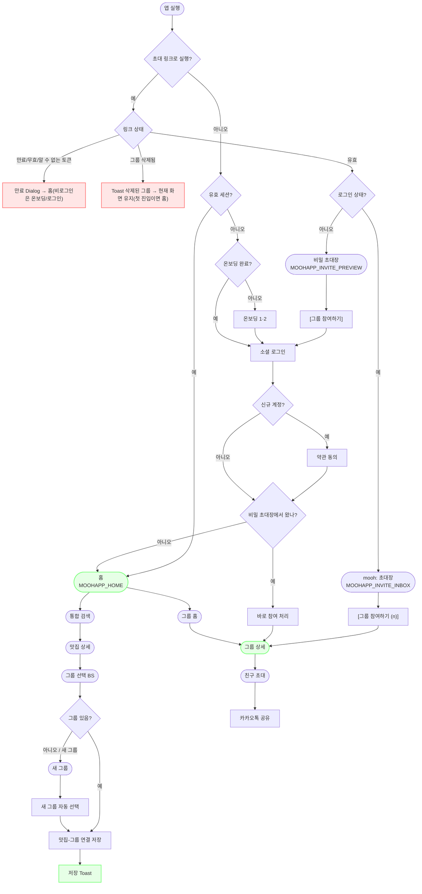

# 03. 사용자 플로우

## 1. 핵심 여정

| Case | 흐름 |
|---|---|
| A. 신규 가입 | 스플래시 → 온보딩 1·2 → 소셜 로그인 → 신규 계정 → 약관 동의(만 14세 이상 확인 포함) → 홈 |
| B. 기존 사용자 | 스플래시 → 세션 확인 → 홈 |
| C. 검색 후 저장 | 홈 검색창 → 검색 → 맛집 상세 → [저장] → 그룹 선택 BS → 그룹 1개 이상 선택 → [완료] → Toast |
| D. 새 그룹 만들며 저장 | 맛집 상세 [저장] → 그룹 선택 BS → [새 그룹 만들기] → 커버·그룹명·설명 입력 → 생성 → 새 그룹 자동 선택 → 저장 완료 |
| F-1. 그룹 초대 (로그인) | (생성자) 그룹 상세 → [공유] → 친구 초대(만료 링크면 자동 재발급) → [카카오톡으로 공유] → 받은 사람 카톡 메시지 버튼 → mooh: 초대장 → [그룹 참여하기 (n)] → 그룹 상세 (2개 이상이면 그룹 홈, D74) |
| F-2. 그룹 초대 (비로그인) | 카톡 메시지 버튼(앱 미설치면 App Store → 설치 후 메시지 다시 누르기, D55) → 비밀 초대장 → [그룹 참여하기] → 로그인(신규면 약관) → 바로 참여 → 그룹 상세 |
| G. 그룹 삭제 | 생성자: 그룹 상세 → 설정 → 그룹 수정 → 삭제 → 확인 Dialog → 그룹 홈. 멤버: 알림함에 안내 |
| H. 정원 초과 | 초대 링크 진입 → 멤버 20명 확인 → 참여 불가 Dialog |
| J. 함께 맛집 추가 | 그룹 상세 → [맛집 추가] → 통합 검색(추가 모드) → 결과 카드 [추가] → Toast (D78) |
| K. 회원 탈퇴 | 마이 → 환경설정 → 회원 탈퇴 → 확인 Dialog → 가입한 provider로 재로그인 → 처리 → 로그인 화면 (D82) |

## 2. 전체 흐름도

## 3. 화면 연결 요약

### 홈
- 프로필 → 마이
- 검색창 → 통합 검색
- Hero Banner → 맛집형: 맛집 상세 / 외부 링크형: 브라우저
- 최근 그룹 카드 → 그룹 상세, [더보기] → 그룹 홈
- 최근 추가된 맛집 카드 → 맛집 상세, 그룹 태그 → 해당 그룹 상세, [더보기] → 그룹 홈
- 친구 아바타 → 함께하는 그룹이 1개면 그 그룹 상세, 2개 이상이면 그룹 목록 바텀시트
- 연결 대상이 없거나 조회 실패 → 현재 화면 유지 + 오류 Toast

### 검색
- 맛집 결과 → 맛집 상세
- 상세에서 뒤로 → 검색어·탭·결과·스크롤 유지
- 추가 모드(그룹 상세 `[맛집 추가]`): 결과 `[추가]` → 그 그룹에 바로 추가, 카드 본문 → 맛집 상세 (D78)

### 저장
- `상세 또는 카드 → [저장] → 그룹 선택 BS → [완료]`
- 그룹이 없으면 `저장 → 새 그룹 → 생성 → 자동 선택 → 저장 완료`

### 새 그룹 생성
- 그룹 홈에서 진입: 생성 → 그룹 상세
- 저장 중 진입: 생성 → 그룹 선택 BS로 복귀, 새 그룹 자동 선택

### 길찾기
- `맛집 상세 → 길찾기 → 카카오맵 앱(미설치 시 웹)` / 연결 실패 시 상세 유지 + Toast / 복귀 시 상세 상태 유지
