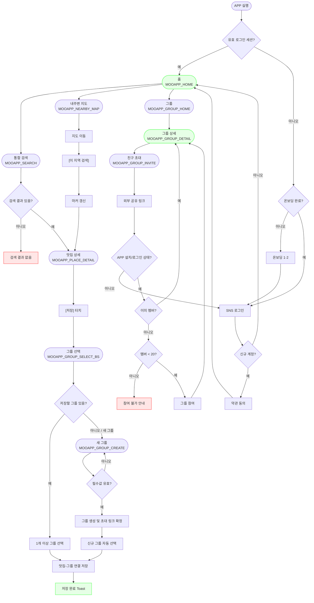

# MOO APP - 맛집 탐색·그룹 저장·공유 기획명세서

> 서비스명: **MOO : 맛집 지도**  
> 플랫폼: **iOS / Android APP**  
> 기준: 제공된 `MOO 맛집 지도 APP 기획서 V2` + 최신 화면 시안 우선 반영  
> 화면 시안과 기존 문서가 충돌하는 항목은 본 문서에서 **최신 화면 시안 기준으로 재정의**한다.

## 1. 개요

### 1.1. 배경 및 가설
* **배경**: 맛집 정보는 검색·지도·SNS 등 여러 채널에 흩어져 있으며, 사용자가 실제로 다시 방문하고 싶은 장소를 개인적으로 정리하거나 친구와 공동 관리하기 어렵다.
* **제공 가치**: 지도 기반 맛집 탐색, 음식점 저장, 그룹 단위 정리, 초대 링크를 통한 공동 편집 환경을 하나의 앱에서 제공한다.
* **[가설] 가설 설정**: 음식점을 발견한 직후 1~2단계 안에 그룹에 저장할 수 있고, 공유 그룹에서 친구와 같은 맛집 목록을 편집할 수 있으면 맛집 재탐색 비용이 줄고 저장·재방문 행동이 증가할 것으로 예상한다.

### 1.2. 타겟 역할 및 기대 효과
* **타겟 역할**: 맛집을 자주 검색·저장하고, 친구·연인·가족과 방문 후보를 공유하는 개인 사용자.
* **기대 효과**: 흩어진 맛집 링크와 캡처를 그룹 단위로 정리하고, 지도에서 위치를 직관적으로 확인하며, 별도의 친구 관계 생성 없이 초대 링크로 공동 리스트를 관리할 수 있다.

### 1.3. 참고 문서
* `MOO_맛집지도_APP_최종기획서.md`
* 최신 APP 화면 시안: Splash / Login / Signup / Onboarding / Main / Search / Detail / Group / Map / Invite
* 공통 Toast / Dialog / Bottom Sheet 가이드가 별도 존재하는 경우 해당 가이드를 우선 적용한다.

### 1.4. 공통 UI/UX 및 용어 정책
* 하단 내비게이션 명칭은 최신 시안 기준 `홈 / 내주변 / 그룹 / 마이`로 통일한다. 기존 문서의 `저장` 탭 명칭은 사용하지 않는다.
* 음식점 객체는 `맛집` 또는 데이터 필드에서는 `place`, 사용자가 맛집을 묶는 단위는 `그룹`, 그룹에 연결된 맛집은 `그룹 맛집`, 그룹 참여자는 `멤버`로 통일한다.
* `친구`는 별도 친구 요청 관계가 아니라 **동일 그룹에 참여 중인 멤버**를 사용자 친화적으로 표현할 때만 사용한다.
* 모든 하위 페이지는 Stack 방식으로 진입하고, 입력·선택 보조 기능은 Bottom Sheet / Full-popup / Dialog를 사용한다.
* 입력 화면에서 닫기·뒤로가기 시 별도 이탈 확인 Dialog를 제공하지 않으며 작성 중 데이터는 폐기한다.
* 서버 변경 요청 중에는 CTA를 로딩 상태로 전환하고 중복 터치를 차단한다.
* 이미지 형태는 프로필 `원형`, 맛집 `라운드 정사각`, 그룹 커버 `라운드 직사각`을 기본으로 한다.
* 최신 시안 기준 그룹명은 **띄어쓰기 포함 최대 15자**, 그룹 설명은 **띄어쓰기 포함 최대 15자**로 적용한다.
* 그룹당 저장 맛집 최대 **500개**, 공유 그룹 멤버 최대 **20명**으로 제한한다.
* 사용자당 그룹 최대 개수는 MVP 운영값 **100개**를 기본값으로 사용하되 서버 설정값으로 관리한다.
* 지도/검색/그룹 목록에서 이전 화면 복귀 시 검색어, 필터, 스크롤, 지도 위치를 가능한 범위에서 유지한다.

---

## 2. 사용자 여정 및 플로우 차트

### 2.1. 핵심 사용자 여정
* **Case A (정상 - 신규 가입)**: Splash ➔ 최초 사용자 여부 확인 ➔ Onboarding 1 ➔ Onboarding 2 ➔ SNS Login ➔ 신규 계정 판정 ➔ 약관 동의 ➔ 홈 진입.
* **Case B (정상 - 검색 후 그룹 저장)**: 홈 검색창 ➔ 검색 화면 ➔ 맛집 검색 ➔ 맛집 상세 ➔ `[저장]` ➔ 그룹 선택 바텀시트 ➔ 1개 이상 그룹 선택 ➔ `[완료]` ➔ 저장 반영.
* **Case C (정상 - 새 그룹 생성 후 저장)**: 맛집 상세 `[저장]` ➔ 그룹 선택 바텀시트 ➔ `[새 그룹 만들기]` ➔ 커버/그룹명/설명 입력 ➔ 그룹 생성 ➔ 신규 그룹 자동 선택 ➔ 맛집 저장 완료.
* **Case D (정상 - 지도 탐색)**: 내주변 진입 ➔ 현재 위치 또는 기본 지역 지도 ➔ 카테고리 선택 ➔ 지도 이동 ➔ `[이 지역 검색]` ➔ 마커 갱신 ➔ 마커 선택 ➔ 요약 카드 ➔ 맛집 상세.
* **Case E (정상 - 공유 그룹 초대)**: 그룹 상세 ➔ `[친구 초대]` ➔ 초대 링크 공유 ➔ 초대받은 사용자 링크 진입 ➔ 로그인/가입 ➔ 그룹 참여 확인 ➔ 참여 완료 ➔ 그룹 상세.
* **Case F (예외 - 그룹 삭제)**: 생성자 그룹 상세 ➔ 그룹 수정 ➔ 삭제 아이콘 ➔ 삭제 확인 Dialog ➔ 삭제 ➔ 별도 완료 안내 없이 그룹 홈 이동 ➔ 전 멤버 화면에서 즉시 제거.
* **Case G (예외 - 초대 정원 초과)**: 초대 링크 진입 ➔ 그룹 멤버 20명 검증 ➔ 정원 도달 ➔ 참여 CTA 차단 및 안내 노출.
* **Case H (예외 - 지도 위치 권한 거부)**: 내주변 진입 ➔ 위치 권한 미허용 ➔ 기본 지역 지도 노출 ➔ 현재 위치 버튼 선택 ➔ 권한 안내 ➔ 영구 거부 시 OS 설정 이동 제공.

### 2.2. 비즈니스 로직 플로우 차트


---

## 3. 비즈니스 룰 및 정책 정의

### 3.1. 권한 및 접근 정책
| 구분 | 정책 항목 | 조건 및 제약 | 결과 및 액션 |
| --- | --- | --- | --- |
| **탐색** | 기본 탐색 | 로그인 완료 사용자 | 홈·검색·지도·맛집 상세 접근 가능 |
| **로그인** | SNS 로그인 | 카카오, 네이버, Apple, Google | 인증 성공 후 기존 계정 매핑 또는 신규 가입 진행 |
| **저장** | 그룹 저장 | 로그인 필수 | 그룹 선택 후 맛집 저장 가능 |
| **그룹** | 생성/편집 | 로그인 필수 | 생성자는 그룹 정보 수정·삭제·멤버 관리 가능 |
| **공유** | 멤버 권한 | 초대 링크 참여 완료 | 그룹 맛집 추가·삭제 가능, 그룹 기본정보 수정·삭제 불가 |
| **비멤버** | 그룹 접근 | 초대 링크 외 직접 접근 | 그룹 데이터 미노출, 그룹 홈 또는 참여 화면으로 이동 |
| **삭제 그룹** | 재접근 | 딥링크·캐시·과거 링크 | 삭제 안내 페이지 없이 그룹 홈 이동 |

### 3.2. 핵심 도메인 정책
| 분류 | 정책 항목 | 주요 내용 (비즈니스 룰) |
| --- | --- | --- |
| **계정** | **SNS 로그인** | - 카카오·네이버·Apple·Google 제공<br>- 동일 provider 계정은 1개 MOO 계정에 매핑<br>- provider 인증 취소 시 로그인 화면 유지<br>- 세션 만료 시 로그인 후 가능한 경우 원래 화면 복귀 |
| **가입** | **약관 동의** | - 이용약관·개인정보 수집 및 이용 동의는 필수<br>- 위치기반서비스·마케팅·이벤트/서비스 알림은 선택<br>- 전체 동의는 하위 항목을 일괄 제어하되 필수/선택 여부 라벨 유지 |
| **검색** | **최근 검색어** | - 최대 10개<br>- 최근 검색순<br>- 개별 삭제·전체 삭제 가능<br>- 동일 검색어 재검색 시 최신 위치로 갱신 |
| **검색** | **검색어 검증** | - 공백 제거 후 1자 이상<br>- 음식점명·지역·역명·주소·음식 카테고리 대상<br>- 연속 입력은 디바운스 적용 권장 |
| **지도** | **검색 범위** | - 지도 이동만으로 결과 자동 갱신하지 않음<br>- 이동 후 `[이 지역 검색]` 노출<br>- 터치 시 현재 viewport 기준 재조회 |
| **지도** | **마커** | - 일반 맛집·저장 맛집·선택 맛집·클러스터·현재 위치 상태 구분<br>- 동일 맛집이 여러 그룹에 저장되어도 지도 마커는 1개 |
| **맛집** | **상세 데이터** | - 대표 이미지, 맛집명, 카테고리, 주소, 전화번호, 영업시간, 지도 위치 제공<br>- 데이터 미제공 항목은 영역 단위 미노출<br>- 장소 삭제 상태는 신규 저장 차단 |
| **길찾기** | **카카오맵 연동** | - MOO 내부 경로 탐색 미제공<br>- 좌표 또는 주소를 카카오맵 앱/웹에 전달<br>- 좌표와 주소 모두 없으면 CTA 미노출 |
| **그룹** | **그룹 기본값** | - 그룹명 필수, 1~15자<br>- 설명 필수, 1~15자<br>- 커버 이미지 선택<br>- 동일 그룹명 허용<br>- 이모지 허용<br>- 앞뒤 공백 제거 |
| **그룹** | **그룹 제한** | - 사용자당 최대 100개(운영 설정값)<br>- 그룹당 맛집 최대 500개<br>- 공유 멤버 최대 20명<br>- 제한 도달 시 추가 CTA 비활성화 및 안내 |
| **그룹** | **초대 링크** | - 그룹 생성 화면 진입 시 임시 초대 토큰을 발급할 수 있으며 생성 완료 시 활성 링크로 확정<br>- 생성 이탈 시 임시 토큰 폐기<br>- 그룹 삭제 시 링크 즉시 비활성<br>- 링크 재발급 시 구 링크 비활성 |
| **그룹** | **정렬** | - 기본 `최근 수정순`<br>- `그룹 이름순`, `그룹 인원순`, `저장순` 지원<br>- 최근 수정일 라벨은 오늘/어제/2~7일 전/1~5주 전/1~12개월 전/1년 전 이상 단위로 상대 표기 가능 |
| **그룹** | **공동 편집** | - 생성자와 일반 멤버 모두 맛집 추가·삭제 가능<br>- 동일 그룹에 동일 맛집 중복 저장 불가<br>- 서버 최신 상태 기준 동시성 처리 |
| **그룹** | **삭제** | - 최초 생성자만 가능<br>- 삭제 성공 후 성공 Toast·완료 페이지 미제공<br>- 모든 멤버 목록·홈 최근 그룹에서 즉시 제거<br>- 다른 그룹의 동일 맛집 저장은 유지 |
| **저장** | **다중 그룹 저장** | - 한 맛집을 여러 그룹에 저장 가능<br>- 그룹 선택 바텀시트에서 기존 저장 그룹 체크 상태 반영<br>- 전체 체크 해제 후 완료 시 해당 맛집 전체 저장 해제 |
| **멤버** | **내보내기** | - 생성자만 다른 멤버 내보내기 가능<br>- 본인은 내보내기 대상에서 제외<br>- 내보낸 멤버는 해당 그룹 접근 및 편집 즉시 차단 |
| **멤버** | **나가기** | - 일반 멤버는 그룹 나가기 가능<br>- 생성자는 나가기 대신 그룹 삭제 또는 소유권 정책 필요<br>- MVP에서는 생성자 소유권 이전 미지원 |
| **빈 화면** | **다음 행동 제공** | - 검색/그룹/맛집 없음 등 빈 화면은 캐릭터 + 안내 문구 + 가능한 경우 CTA 제공 |

### 3.3. 그룹 권한 매트릭스
| 기능 | 그룹 생성자 | 일반 멤버 | 비멤버 |
| --- | --- | --- | --- |
| 그룹 상세 조회 | 가능 | 가능 | 불가 |
| 그룹명·설명·커버 수정 | 가능 | 불가 | 불가 |
| 맛집 추가 | 가능 | 가능 | 불가 |
| 맛집 삭제 | 가능 | 가능 | 불가 |
| 초대 링크 공유 | 가능 | 가능 | 불가 |
| 초대 링크 재발급 | 가능 | 불가 | 불가 |
| 멤버 내보내기 | 가능 | 불가 | 불가 |
| 그룹 나가기 | 미지원 | 가능 | - |
| 그룹 삭제 | 가능 | 불가 | 불가 |

### 3.4. 그룹 및 맛집 상태값 정의
| 분류 | 상태값 | 정의 | 주요 UI 처리 |
| --- | --- | --- | --- |
| **그룹** | `ACTIVE` | 정상 사용 가능한 그룹 | 목록·상세 노출 |
| | `DELETED` | 생성자가 삭제한 그룹 | 전 화면 미노출, 재접근 시 그룹 홈 이동 |
| **멤버** | `OWNER` | 최초 그룹 생성자 | 설정·삭제·멤버 관리 권한 |
| | `MEMBER` | 초대 링크로 참여한 일반 멤버 | 맛집 공동 편집 가능 |
| | `LEFT` | 그룹에서 나간 사용자 | 그룹 접근 불가 |
| | `REMOVED` | 생성자에 의해 내보내진 사용자 | 그룹 접근 불가 |
| **초대 링크** | `ACTIVE` | 참여 가능한 링크 | 그룹 참여 화면 진입 |
| | `EXPIRED` | 유효기간 종료 | 만료 안내 |
| | `DISABLED` | 재발급·수동 비활성 | 사용 불가 안내 |
| | `GROUP_DELETED` | 그룹 삭제 연동 | 그룹 홈 이동 |
| | `FULL` | 그룹 멤버 20명 도달 | 참여 불가 안내 |
| **맛집** | `AVAILABLE` | 정상 조회 가능 | 탐색·저장 가능 |
| | `UNAVAILABLE` | 원천 데이터 삭제/중단 | 상세 제한, 신규 저장 불가, 기존 그룹에서 제거 가능 |

### 3.5. 저장/그룹 동시성 정책
* 맛집 저장 요청은 `account_id + group_id + place_id` 기준 중복 연결 생성을 차단한다.
* 동일 그룹에 두 멤버가 같은 맛집을 동시에 추가한 경우 최초 성공 1건만 유지하고 이후 요청에는 최신 상태를 반환한다.
* 이미 삭제된 그룹 맛집을 다른 멤버가 다시 삭제하면 오류 페이지 없이 목록을 최신화한다.
* 그룹 삭제 직전 권한과 그룹 상태를 재검증한다.
* 초대 참여 직전 그룹 상태, 링크 상태, 멤버 수를 다시 검증한다.

### 3.6. 최신 시안 우선 반영 정책
* 하단 탭은 `저장`이 아니라 **`그룹`**으로 사용한다.
* 그룹 생성/수정 화면은 시안에 맞춰 **그룹 설명 필드**를 사용한다.
* 그룹명·설명 입력 제한은 시안 기준 각각 **최대 15자**로 적용한다.
* 그룹 상세는 `맛집 N/500`, `멤버 N/20` 탭 구조를 사용한다.
* 맛집 상세 하단은 전화 아이콘 + `[저장]` Primary CTA 구조를 사용한다.
* 지도는 상단 검색창, 가로 카테고리/추천 칩, `[이 지역 검색]`, `[목록 보기]`, 현재 위치 플로팅 버튼을 기본 구조로 사용한다.

---

## 4. 기능 및 UI 요건 명세

### 4.1. 스플래시 화면 (화면 ID: MOOAPP_SPLASH)

```text
+-----------------------------------+
|                                   |
|          [MOO 캐릭터]             |
|                    [위치 핀]      |
|                                   |
|        귀엽고 쫀득한              |
|        아궁빵 찾기!               |
|                                   |
|    MOO: 같이 모으는 우리만의 맛집 지도 |
|                                   |
+-----------------------------------+
```

**① 화면 구성 필수 요건**
| 영역 | 노출 데이터 / 컴포넌트 | 액션 및 결과 (개조식 작성) |
| --- | --- | --- |
| **브랜드 비주얼** | MOO 캐릭터·위치 핀 | - 중앙 비주얼 노출<br>- 로딩 중 레이아웃 고정 |
| **카피** | 메인/서브 카피 | - 최신 시안 카피 적용<br>- 별도 CTA 없음 |

**② 상호작용 및 UX 조건**
* 앱 초기화·세션 확인이 끝나면 최초 사용자 여부에 따라 온보딩 또는 홈/로그인으로 자동 이동한다.
* 초기화 실패가 장시간 지속될 경우 네트워크 재시도 화면으로 전환한다.

### 4.2. 로그인 화면 (화면 ID: MOOAPP_LOGIN)

```text
+-----------------------------------+
|                                   |
|              MOO                  |
|     같이 모으는 우리만의 맛집 지도 |
|                                   |
|       [캐릭터 + 지도 비주얼]      |
|                                   |
|         SNS 계정으로 간편 로그인  |
|   [카카오] [네이버] [Apple] [Google]|
|                                   |
| 로그인 시 이용약관 및 개인정보... |
+-----------------------------------+
```

**① 화면 구성 필수 요건**
| 영역 | 노출 데이터 / 컴포넌트 | 액션 및 결과 (개조식 작성) |
| --- | --- | --- |
| **브랜드** | MOO 로고·서비스 설명 | - 화면 상단~중앙 배치 |
| **SNS 로그인** | 4종 원형 버튼 | - 카카오, 네이버, Apple, Google 순 노출<br>- 터치 시 각 provider 인증 호출 |
| **고지** | 약관·개인정보 문구 | - 이용약관/개인정보처리방침 텍스트 링크 제공 가능 |

**② 상호작용 및 UX 조건**
* 인증 성공 후 신규 계정이면 회원가입 약관 화면, 기존 계정이면 홈으로 이동한다.
* 인증 취소 시 현재 화면 유지, 실패 시 실패 Toast를 노출한다.
* 중복 터치 방지를 위해 인증 진행 중 다른 SNS 버튼을 비활성화한다.

### 4.3. 신규 가입 약관 화면 (화면 ID: MOOAPP_SIGNUP_TERMS)

```text
+-----------------------------------+
|              신규 가입       [X] |
|                                   |
|          [MOO 캐릭터]             |
| 서비스 이용을 위해                |
| 약관에 동의해 주세요              |
|                                   |
| ( ) 전체 동의                     |
| --------------------------------- |
| (v) 이용약관 동의 (필수)       >  |
| ( ) 개인정보 수집 및 이용 (필수)> |
| ( ) 위치기반서비스 이용 (선택) >  |
| ( ) 마케팅 정보 수신 (선택)    >  |
| ( ) 이벤트/서비스 알림 (선택)  >  |
|                                   |
| [             확인             ] |
+-----------------------------------+
```

**① 화면 구성 필수 요건**
| 영역 | 노출 데이터 / 컴포넌트 | 액션 및 결과 (개조식 작성) |
| --- | --- | --- |
| **헤더** | 타이틀·닫기 | - `[X]` 터치 시 가입 중단 및 로그인 복귀 |
| **전체 동의** | 체크박스 | - 하위 약관 일괄 선택/해제 |
| **개별 약관** | 필수/선택 약관 목록 | - 행 터치 시 체크, `>` 터치 시 전문 보기 |
| **CTA** | `[확인]` | - 필수 약관 모두 동의 시 활성화 |

**② 상호작용 및 UX 조건**
* 선택 약관 미동의 상태에서도 가입 가능하다.
* 전문 화면 복귀 시 기존 체크 상태를 유지한다.

### 4.4. 온보딩 화면 (화면 ID: MOOAPP_ONBOARDING)

```text
[PAGE 1]
+-----------------------------------+
|       [맛집 이미지 Full]          |
|                                   |
| 나만의 맛집은                     |
| 저장해 두세요.                    |
| 작은 설명 문구                    |
|                                   |
| [              다음             ]|
+-----------------------------------+

[PAGE 2]
+-----------------------------------+
|       [함께 보는 이미지 Full]     |
|                                   |
| 친구와 함께                      |
| 맛집을 모아요.                    |
| 공유 그룹 설명                    |
|                                   |
| [            시작하기           ]|
+-----------------------------------+
```

**① 화면 구성 필수 요건**
| 영역 | 노출 데이터 / 컴포넌트 | 액션 및 결과 (개조식 작성) |
| --- | --- | --- |
| **배경** | 풀 이미지 | - 텍스트 가독성을 위한 하단 Dim/Gradient 적용 |
| **본문** | 단계 라벨·메인·서브 카피 | - 시안 기준 좌측 정렬 |
| **CTA** | 다음 / 시작하기 | - 1페이지 `다음`, 2페이지 `시작하기` |

**② 상호작용 및 UX 조건**
* 최초 설치 후 1회 노출하며 완료 상태를 로컬에 저장한다.
* 2페이지 완료 후 로그인 화면으로 이동한다.

### 4.5. 홈 화면 (화면 ID: MOOAPP_HOME)

```text
+-----------------------------------+
| WELCOME                    [프로필]|
| 백주희님 👋                       |
| [ 지역이나 음식점을 검색해 주세요 ]|
|                                   |
| [        Hero Banner            ] |
|                                   |
| 최근 그룹                     더보기|
| [그룹][그룹][그룹] ->             |
|                                   |
| 최근 저장한 맛집              더보기|
| [IMG] 맛집명             [저장]   |
| [IMG] 맛집명             [저장]   |
| [IMG] 맛집명             [저장]   |
|                                   |
| [나만 아는 맛집 친구랑 공유해볼까?]|
| 함께하는 MOO 친구                |
| (프로필) (프로필) (프로필) ->     |
|                                   |
| 사업자/약관/개인정보/문의          |
+-----------------------------------+
| 홈 | 내주변 | 그룹 | 마이          |
+-----------------------------------+
```

**① 화면 구성 필수 요건**
| 영역 | 노출 데이터 / 컴포넌트 | 액션 및 결과 (개조식 작성) |
| --- | --- | --- |
| **웰컴 헤더** | WELCOME·닉네임·프로필 | - 닉네임 말줄임 처리<br>- 프로필 터치 > 마이 이동 |
| **검색** | 통합 검색 진입창 | - 터치 > `MOOAPP_SEARCH` |
| **Hero** | 시즌/지역 추천 배너 | - 전체 카드 CTA<br>- 연결 대상에 따라 지도/맛집 상세/콘텐츠 이동 |
| **최근 그룹** | 가로 카드 | - 최근 수정순 최대 5개<br>- 그룹명·멤버 수·맛집 수·공유 표시<br>- 카드 > 그룹 상세 |
| **최근 맛집** | 세로 리스트 | - 최근 저장순 최대 5개<br>- 저장 그룹 태그 노출<br>- 저장 아이콘 > 그룹 선택 바텀시트 |
| **공유 유도** | 캐릭터 인라인 배너 | - 그룹 만들기/공유 기능 유도 |
| **함께하는 친구** | 멤버 Avatar | - 동일 그룹 참여 멤버 최근 활동순<br>- 터치 > 함께 참여 중 그룹 목록 |
| **푸터** | 사업자·약관 링크 | - 서비스 정보 텍스트 노출 |
| **Bottom Nav** | 홈/내주변/그룹/마이 | - 홈 활성 상태 |

**② 상호작용 및 UX 조건**
* 각 데이터 섹션은 독립적으로 로딩하고 스켈레톤을 적용한다.
* 최근 그룹/맛집이 0건이면 해당 Empty State 또는 기능 유도 배너를 노출한다.
* Hero 연결 대상이 삭제되거나 유효하지 않으면 현재 화면 유지 + 오류 Toast.

### 4.6. 통합 검색 화면 (화면 ID: MOOAPP_SEARCH)

```text
[검색 전]
+-----------------------------------+
| < [ 지역이나 음식점을 검색해 주세요 ]|
|                                   |
| 최근 검색어               전체 삭제|
| ○ 을지로 맛집                  [X] |
| ○ 홍대 카페                    [X] |
| ○ 신사역 피자스쿨             [X] |
+-----------------------------------+

[검색 결과]
+-----------------------------------+
| < [ 신사                         ]|
| 총 5개                            |
| [IMG] 신사역 스시냥냥      [저장] |
|       일식 · 신사                |
| [IMG] 또래오래 신사역점    [저장] |
| ...                               |
+-----------------------------------+

[결과 없음]
+-----------------------------------+
| < [ 신사나나                     ]|
|                                   |
|          [MOO 캐릭터]             |
|        검색 결과가 없어요         |
| 다른 이름이나 지역으로 검색해 주세요|
+-----------------------------------+
```

**① 화면 구성 필수 요건**
| 영역 | 노출 데이터 / 컴포넌트 | 액션 및 결과 (개조식 작성) |
| --- | --- | --- |
| **검색창** | 인풋·초기화 | - 1자 이상 입력<br>- 검색어 입력 시 clear 아이콘 노출 |
| **최근 검색** | 최대 10개 | - 최신순<br>- 개별 `[X]`, 전체 삭제 제공 |
| **결과** | 맛집 리스트 | - 썸네일·맛집명·카테고리·지역·저장 상태<br>- 카드 > 맛집 상세 |
| **저장** | 북마크 아이콘 | - 터치 > 그룹 선택 바텀시트 |
| **Empty** | 캐릭터·문구 | - 결과 0건 시 단독 노출 |

**② 상호작용 및 UX 조건**
* 검색 요청은 디바운스 또는 검색 완료 액션을 사용한다.
* 지역/역명 결과를 별도 타입으로 제공하는 경우 터치 시 지도 중심점을 변경한다.
* 상세 복귀 시 검색어·결과·스크롤 위치를 유지한다.

### 4.7. 맛집 상세 화면 (화면 ID: MOOAPP_PLACE_DETAIL)

```text
+-----------------------------------+
| < [홈]                        [공유]|
| [        대표 이미지             ]|
|                                   |
| 평거린양꼬치 신사점          [저장]|
| 일식 · 신사                      |
|                                   |
| [주소 아이콘] 서울 강남구 ...     |
| [전화] 02)0000-0000               |
| [시간] 영업중  오늘 11:00~01:30  v|
|                                   |
| [월~일 영업시간 상세 - 펼침 시]   |
|                                   |
| [          지도 이미지           ]|
| [      카카오맵으로 길찾기        ]|
|                                   |
+-----------------------------------+
| [전화] [            저장          ]|
+-----------------------------------+
```

**① 화면 구성 필수 요건**
| 영역 | 노출 데이터 / 컴포넌트 | 액션 및 결과 (개조식 작성) |
| --- | --- | --- |
| **헤더** | 뒤로가기·홈·공유 | - 공유는 OS 공유 시트 호출 |
| **대표 이미지** | 맛집 이미지 | - 없으면 기본 이미지 |
| **기본 정보** | 맛집명·카테고리·지역 | - 우측 저장 상태 아이콘 동기화 |
| **주소** | 전체 주소 | - 터치/복사 기능 제공 가능 |
| **전화** | 전화번호 | - 존재 시만 노출 |
| **영업시간** | 오늘 영업 상태 | - 아코디언 토글로 요일별 시간 펼침/접힘 |
| **지도** | 위치 미니맵 | - 위치 확인용 |
| **길찾기** | 카카오맵 CTA | - 앱 설치 여부에 따라 앱/웹 연동 |
| **Bottom CTA** | 전화·저장 | - 전화는 secondary icon, 저장은 Primary |

**② 상호작용 및 UX 조건**
* 저장 터치 시 `MOOAPP_GROUP_SELECT_BS` 호출.
* 이미 저장된 맛집이면 저장된 그룹을 체크 상태로 불러온다.
* 영업시간이 없으면 시간 영역 전체 미노출.
* 좌표와 주소가 모두 없으면 지도/길찾기 미노출.

### 4.8. 그룹 선택 바텀시트 (화면 ID: MOOAPP_GROUP_SELECT_BS)

```text
+-----------------------------------+
| 그룹에 저장                    [X]|
|                                   |
| [IMG] 까치산 맛집        ( )      |
|       멤버 8 · 맛집 18            |
| [IMG] 낙성대입구...      (v)      |
|       멤버 1 · 맛집 157           |
| [IMG] 신사역 맛집        ( )      |
|       멤버 20 · 맛집 80           |
|                                   |
| [+] 새 그룹 만들기                |
|                                   |
| [             완료             ]  |
+-----------------------------------+
```

**① 화면 구성 필수 요건**
| 영역 | 노출 데이터 / 컴포넌트 | 액션 및 결과 (개조식 작성) |
| --- | --- | --- |
| **그룹 목록** | 커버·그룹명·멤버/맛집 수·체크 | - 다중 선택 가능<br>- 기존 저장 그룹은 체크 상태 |
| **새 그룹** | `[새 그룹 만들기]` | - 터치 > 그룹 생성 화면 |
| **CTA** | `[완료]` | - 저장 그룹 변경사항 서버 반영 |

**② 상호작용 및 UX 조건**
* 그룹이 0개면 목록 대신 새 그룹 만들기만 노출한다.
* 신규 그룹 생성 후 복귀 시 해당 그룹 자동 체크.
* 전체 체크 해제 후 완료 시 해당 맛집 저장 해제.

### 4.9. 그룹 홈 화면 (화면 ID: MOOAPP_GROUP_HOME)

```text
+-----------------------------------+
|               그룹                |
|                                   |
| 총 5개                  최근 수정순 v|
|                                   |
| [IMG] 까치산 맛집                 |
|       까치산맛집                  |
|       멤버 8 · 맛집 23   (멤버들) |
|                                   |
| [IMG] 낙성대입구 맛집 공유...     |
|       멤버 1 · 맛집 32            |
|                                   |
| ...                               |
|                        [+ 새 그룹] |
+-----------------------------------+
| 홈 | 내주변 | 그룹 | 마이          |
+-----------------------------------+
```

**① 화면 구성 필수 요건**
| 영역 | 노출 데이터 / 컴포넌트 | 액션 및 결과 (개조식 작성) |
| --- | --- | --- |
| **헤더** | 타이틀·총 건수 | - 현재 사용 가능한 그룹 수 노출 |
| **정렬** | 드롭다운 | - 최근 수정순(기본), 그룹 이름순, 그룹 인원순, 저장순 |
| **그룹 카드** | 커버·그룹명·멤버 수·맛집 수·Avatar | - 카드 > 그룹 상세<br>- 그룹명 최대 2줄 또는 말줄임 |
| **스와이프 삭제** | 개인 생성 그룹 카드 | - 좌측 슬라이드 시 삭제 버튼 노출 가능<br>- 일반 멤버 그룹은 삭제 대신 나가기 정책 별도 |
| **FAB** | `[+ 새 그룹]` | - 그룹 생성 화면 |

**② 상호작용 및 UX 조건**
* 기본 정렬 `최근 수정순`.
* 상대 날짜 라벨은 오늘/어제/2~7일/1~5주/1~12개월/1년 이상 구간으로 표시 가능.
* 그룹 0건 시 캐릭터 Empty State와 `[+ 새 그룹]` CTA 제공.

### 4.10. 새 그룹 만들기 화면 (화면 ID: MOOAPP_GROUP_CREATE)

```text
+-----------------------------------+
|             새 그룹           [X]|
|                                   |
|          [커버 이미지]            |
|          커버 이미지 선택          |
|                                   |
| 그룹명 (필수)                     |
| [ 그룹명 입력 (최대 15자)        ]|
|                                   |
| 설명 (필수)                       |
| [ 그룹 설명 입력 (최대 15자)     ]|
|                                   |
| 초대 링크                         |
| [ moo.app/invite/............... ]|
|                                   |
| [          그룹 만들기          ] |
+-----------------------------------+
```

**① 화면 구성 필수 요건**
| 영역 | 노출 데이터 / 컴포넌트 | 필수 여부 | 액션 및 결과 (개조식 작성) |
| --- | --- | --- | --- |
| **커버** | 이미지 선택 | 선택 | - 앨범 선택<br>- 미선택 시 기본 MOO 그룹 이미지 |
| **그룹명** | 인풋 | 필수 | - 1~15자, 공백만 불가, 이모지 허용 |
| **설명** | 인풋 | 필수 | - 1~15자, 공백만 불가 |
| **초대 링크** | 읽기 전용 링크 | - | - 임시 토큰 표시 가능<br>- 그룹 생성 완료 시 활성 확정 |
| **CTA** | `[그룹 만들기]` | - | - 필수값 유효 시 활성화 |

**② 상호작용 및 UX 조건**
* `[X]` 터치 시 확인 Dialog 없이 이전 화면으로 이동하고 입력값 폐기.
* 이미지 업로드 실패 시 기본 이미지로 계속 생성 가능.
* 생성 중 CTA 로딩·중복 터치 차단.
* 저장 플로우에서 진입한 경우 생성 성공 후 그룹 자동 선택 및 맛집 저장을 이어서 처리한다.

### 4.11. 그룹 상세 화면 (화면 ID: MOOAPP_GROUP_DETAIL)

```text
+-----------------------------------+
| <  [홈]                   [공유][설정]|
| [          그룹 커버             ]|
|                                   |
| 데이트 코스                 [지도]|
| 홍대, 종로 일대 맛집 모음         |
|                                   |
| [ 맛집 (23/500) ] [ 멤버 (3/20) ]|
| --------------------------------- |
| [IMG] 신사역 스시냥냥       [저장]|
|       일식·신사  영업시간         |
| [IMG] 또래오래 신사역점     [저장]|
| ...                               |
|                                   |
| [             맛집 추가          ]|
+-----------------------------------+
```

**① 화면 구성 필수 요건**
| 영역 | 노출 데이터 / 컴포넌트 | 액션 및 결과 (개조식 작성) |
| --- | --- | --- |
| **헤더** | 뒤로/홈/공유/설정 | - 공유 > OS 공유 또는 초대 화면<br>- 설정 > 그룹 수정(생성자) 또는 나가기 메뉴(멤버) |
| **커버** | 그룹 대표 이미지 | - 라운드 직사각 형태 |
| **그룹 정보** | 그룹명·설명·지도 아이콘 | - 지도 아이콘 > 그룹 맛집 지도 보기 |
| **탭** | 맛집 N/500 · 멤버 N/20 | - 탭 전환 |
| **맛집 탭** | 그룹 맛집 리스트 | - 맛집 카드 > 상세<br>- 저장/삭제 액션 상태 노출 |
| **멤버 탭** | Avatar·닉네임·역할 | - 생성자는 멤버별 `[내보내기]` 제공<br>- 본인 행은 역할 표시 |
| **Bottom CTA** | `[맛집 추가]` | - 검색/지도 기반 그룹 맛집 추가 플로우 |

**② 상호작용 및 UX 조건**
* 그룹 맛집 500개 도달 시 `[맛집 추가]` 비활성화 + 제한 안내.
* 멤버 20명 도달 시 초대 CTA 비활성화 또는 초대 화면에서 정원 안내.
* 맛집 0건 시 캐릭터 Empty State + `[맛집 추가]` CTA.
* 삭제된 그룹을 보고 있는 중 갱신되면 별도 완료 화면 없이 그룹 홈으로 이동.

### 4.12. 그룹 수정 화면 (화면 ID: MOOAPP_GROUP_EDIT)

```text
+-----------------------------------+
|             그룹 수정         [X]|
|          [커버 이미지]            |
| 그룹명 (필수)                     |
| [ 데이트 코스                    ]|
| 설명 (필수)                       |
| [ 홍대, 종로 일대 맛집 모음      ]|
| 초대 링크                         |
| [ moo.app/invite/............... ]|
|                                   |
| [삭제 아이콘]                     |
| [              수정             ]|
+-----------------------------------+
```

**① 화면 구성 필수 요건**
| 영역 | 노출 데이터 / 컴포넌트 | 필수 여부 | 액션 및 결과 (개조식 작성) |
| --- | --- | --- | --- |
| **기본 정보** | 커버·그룹명·설명 | 그룹명/설명 필수 | - 생성자만 수정 가능 |
| **초대 링크** | 읽기 전용 | - | - 복사/재발급 기능 별도 제공 가능 |
| **삭제** | 휴지통 아이콘 | - | - 생성자에게만 노출<br>- 삭제 확인 Dialog 호출 |
| **CTA** | `[수정]` | - | - 변경사항 유효 시 저장 |

**② 상호작용 및 UX 조건**
* `[X]` 이탈 시 입력값 폐기, 확인 팝업 없음.
* 삭제 성공 후 별도 성공 메시지 없이 그룹 홈으로 이동한다.

### 4.13. 친구 초대 화면 (화면 ID: MOOAPP_GROUP_INVITE)

```text
+-----------------------------------+
|             친구 초대         [X]|
|          [그룹 커버]              |
|             데이트 코스           |
|     홍대, 종로 일대 맛집 모음     |
|          [공유 그룹 뱃지]          |
|                                   |
| 함께 멤버                         |
| (나) (멤버) (멤버) ...            |
|                                   |
| 초대 링크                         |
| [ moo.app/invite/............... ]|
|                                   |
| [            링크 공유하기       ]|
+-----------------------------------+
```

**① 화면 구성 필수 요건**
| 영역 | 노출 데이터 / 컴포넌트 | 액션 및 결과 (개조식 작성) |
| --- | --- | --- |
| **그룹 요약** | 커버·그룹명·설명·맛집/멤버 수 | - 현재 그룹 데이터 표시 |
| **멤버** | Avatar 목록 | - 최대 20명 범위 표시 |
| **초대 링크** | 링크 | - 읽기 전용·복사 가능 |
| **CTA** | `[링크 공유하기]` | - OS Share Sheet 호출 |

**② 상호작용 및 UX 조건**
* 멤버 20명 도달 시 `최대 인원 20명에 도달했어요.` 안내 및 공유 CTA 비활성화.
* 그룹 삭제/권한 해제 상태에서 진입하면 그룹 홈으로 이동.

### 4.14. 그룹 참여 화면 (화면 ID: MOOAPP_GROUP_JOIN)

```text
+-----------------------------------+
|             moo: 초대장       [X]|
|                                   |
|          [MOO 초대 캐릭터]         |
|   백주희님이 초대했어요            |
|                                   |
| [그룹 커버] 데이트 코스      ( )  |
| [다른 그룹] ...                   |
|                                   |
| [        그룹 참여하기 (n)       ]|
+-----------------------------------+
```

**① 화면 구성 필수 요건**
| 영역 | 노출 데이터 / 컴포넌트 | 액션 및 결과 (개조식 작성) |
| --- | --- | --- |
| **초대 정보** | 초대한 사용자·캐릭터 | - 초대자 닉네임 표시 가능 |
| **그룹 카드** | 초대 대상 그룹 | - 단일 초대 링크는 대상 그룹만 기본 선택 |
| **CTA** | `[그룹 참여하기]` | - 최종 그룹/링크/정원 검증 후 참여 |

**② 상호작용 및 UX 조건**
* 이미 참여 중이면 참여 화면 생략 후 그룹 상세 이동.
* 본인 소유 그룹 링크도 상세로 바로 이동.
* 만료·비활성 링크는 안내 후 홈 또는 그룹 홈 이동 CTA 제공.

### 4.15. 멤버 관리 화면 (화면 ID: MOOAPP_GROUP_MEMBER)

```text
+-----------------------------------+
|              멤버                 |
|                                   |
| (나) 백주희             그룹장    |
| (멤버) 아귀               내보내기|
| (멤버) 양탱               내보내기|
| ...                               |
+-----------------------------------+
```

**① 화면 구성 필수 요건**
| 영역 | 노출 데이터 / 컴포넌트 | 액션 및 결과 (개조식 작성) |
| --- | --- | --- |
| **멤버 목록** | 프로필·닉네임·역할 | - 생성자 자신은 `그룹장` 표시 |
| **내보내기** | 텍스트 버튼 | - 생성자에게만 노출<br>- 확인 Dialog 후 제거 |

**② 상호작용 및 UX 조건**
* 제거 직전 대상 멤버가 여전히 그룹 멤버인지 재검증.
* 이미 나간 멤버면 최신 목록 갱신만 수행.

### 4.16. 내주변 지도 화면 (화면 ID: MOOAPP_NEARBY_MAP)

```text
+-----------------------------------+
| [ 강남구 신사동              🔍 ]|
| [AI 추천][🔥맛집 랭킹][음식점][카페] ->|
|                                   |
|              [이 지역 검색]       |
|                       [목록 보기]  |
|                                   |
|              MAP                  |
|      [한식]    [일식]   [카페]    |
|           [현재위치]               |
|                                   |
| [선택 맛집 요약 카드]             |
| [IMG] 을지로 옛날통닭     [저장] |
|       한식 · 320m · 도보 약 5분   |
|                             [◎]   |
+-----------------------------------+
| 홈 | 내주변 | 그룹 | 마이          |
+-----------------------------------+
```

**① 화면 구성 필수 요건**
| 영역 | 노출 데이터 / 컴포넌트 | 액션 및 결과 (개조식 작성) |
| --- | --- | --- |
| **검색** | 지도 검색창 | - 터치 > 검색 화면 |
| **칩** | AI 추천·맛집 랭킹·음식점·카페 등 | - 가로 스크롤·단일 선택 기본 |
| **지도** | 지도·마커·클러스터 | - viewport 기반 데이터 |
| **이 지역 검색** | 플로팅 CTA | - 지도 이동 후 노출<br>- 현재 영역 재조회 |
| **목록 보기** | 플로팅 CTA | - 동일 검색 조건의 리스트 화면/오버레이 전환 |
| **현재 위치** | GPS 버튼 | - 위치 권한/현재 위치 확인 |
| **요약 카드** | 선택 맛집 카드 | - 카드 > 상세<br>- 저장 > 그룹 선택 |
| **Bottom Nav** | 4탭 | - 내주변 활성 |

**② 상호작용 및 UX 조건**
* 지도 빈 영역 터치 시 선택 카드 닫힘.
* 상세 복귀 시 지도 중심/줌/선택 마커 유지.
* 위치 권한 미허용 시 기본 지역 중심으로 진입한다.

### 4.17. 지도 목록 보기 (화면 ID: MOOAPP_NEARBY_LIST)

```text
+-----------------------------------+
| < 현재 지역 맛집                  |
| [필터 요약]                        |
| [IMG] 맛집명                 [저장]|
|       카테고리 · 320m             |
| [IMG] 맛집명                 [저장]|
| ...                               |
| [             지도 보기          ]|
+-----------------------------------+
```

**① 화면 구성 필수 요건**
| 영역 | 노출 데이터 / 컴포넌트 | 액션 및 결과 (개조식 작성) |
| --- | --- | --- |
| **목록** | 지도 결과 카드 | - 지도와 동일 query/filter 사용 |
| **저장** | 북마크 | - 그룹 선택 BS |
| **전환** | `[지도 보기]` | - 기존 지도 viewport 유지 후 복귀 |

**② 상호작용 및 UX 조건**
* 목록 정렬은 거리순을 기본으로 하고 향후 별도 필터 확장 가능.

### 4.18. 마이 화면 (화면 ID: MOOAPP_MY_HOME)

```text
+-----------------------------------+
|               마이                |
| [프로필] 백주희님                 |
|          SNS 계정                 |
| 그룹 5  | 저장 맛집 230           |
|                                   |
| [프로필 수정]                     |
| 위치 권한 설정                 >  |
| 알림 설정                      >  |
| 이용약관                       >  |
| 개인정보처리방침               >  |
| 문의하기                       >  |
| 앱 버전                          |
| 로그아웃                       >  |
| 회원 탈퇴                      >  |
+-----------------------------------+
| 홈 | 내주변 | 그룹 | 마이          |
+-----------------------------------+
```

**① 화면 구성 필수 요건**
| 영역 | 노출 데이터 / 컴포넌트 | 액션 및 결과 (개조식 작성) |
| --- | --- | --- |
| **프로필** | 이미지·닉네임·계정 | - 기본 프로필 이미지 fallback |
| **활동 요약** | 그룹 수·저장 맛집 수 | - 실시간 집계 |
| **설정** | 권한·알림·약관·문의 | - 각 상세 이동 |
| **계정** | 로그아웃·탈퇴 | - 확인 Dialog 적용 |

**② 상호작용 및 UX 조건**
* 프로필 수정 중 이탈 시 확인 팝업 없이 입력값 폐기.
* 생성한 공유 그룹이 존재하는 상태에서 탈퇴할 경우 그룹 정리 정책을 먼저 안내한다.

---

## 5. 예외 처리 및 시스템 메시지

| 케이스 | 메시지 ID | UI/UX 피드백 방식 | 노출 문구 | 버튼 명칭 | 시스템 처리 |
| --- | --- | --- | --- | --- | --- |
| SNS 로그인 실패 | `MOOAPP_TOAST_LOGIN_FAIL` | Toast · error | 로그인에 실패했어요. 잠시 후 다시 시도해 주세요. | - | 로그인 화면 유지 |
| 필수 약관 미동의 | - | BUTTON_DISABLED | - | - | 가입 확인 버튼 비활성화 |
| 검색 공백 입력 | - | ACTION_BLOCKED | - | - | 검색 실행 안 함 |
| 검색 결과 0건 | - | EMPTY_STATE | 검색 결과가 없어요.<br>다른 이름이나 지역으로 검색해 주세요. | - | 결과 없음 화면 유지 |
| 위치 권한 거부 | `MOOAPP_DIALOG_LOCATION_PERMISSION` | Dialog · alert | 내 주변 맛집을 보려면 위치 권한이 필요해요. | [나중에] / [설정] | 기본 지역 지도 유지 |
| 현재 위치 실패 | `MOOAPP_TOAST_LOCATION_FAIL` | Toast · error | 현재 위치를 확인하지 못했어요. | - | 기존 지도 위치 유지 |
| 지도 로딩 실패 | `MOOAPP_TOAST_MAP_LOAD_FAIL` | Toast · error | 지도를 불러오지 못했어요. | [재시도] | 기존 데이터 유지 |
| 지도 결과 0건 | - | EMPTY_STATE | 이 지역에 표시할 맛집이 없어요. | [필터 초기화] | 지도 유지 |
| 맛집 저장 성공 | `MOOAPP_TOAST_PLACE_SAVE_SUCCESS` | Toast · success | 맛집을 저장했어요. | - | 저장 상태 갱신 |
| 맛집 저장 해제 | `MOOAPP_TOAST_PLACE_UNSAVE_SUCCESS` | Toast · success | 저장을 해제했어요. | - | 저장 상태 갱신 |
| 맛집 저장 실패 | `MOOAPP_TOAST_PLACE_SAVE_FAIL` | Toast · error | 저장하지 못했어요. 잠시 후 다시 시도해 주세요. | - | 선택 상태 유지 |
| 동일 그룹 맛집 중복 추가 | `MOOAPP_TOAST_PLACE_DUPLICATED` | Toast · info | 이미 이 그룹에 저장된 맛집이에요. | - | 중복 연결 생성 차단 |
| 그룹 생성 필수값 누락 | - | BUTTON_DISABLED | - | - | `[그룹 만들기]` 비활성화 |
| 그룹 생성 실패 | `MOOAPP_TOAST_GROUP_CREATE_FAIL` | Toast · error | 그룹을 만들지 못했어요. 잠시 후 다시 시도해 주세요. | - | 입력값 유지 |
| 그룹 100개 도달 | `MOOAPP_DIALOG_GROUP_LIMIT` | Dialog · alert | 만들 수 있는 그룹 수를 모두 사용했어요. | [확인] | 신규 그룹 생성 차단 |
| 그룹 맛집 500개 도달 | `MOOAPP_TOAST_GROUP_PLACE_LIMIT` | Toast · warning | 이 그룹에는 맛집을 최대 500개까지 저장할 수 있어요. | - | 추가 차단 |
| 그룹 멤버 20명 도달 | `MOOAPP_DIALOG_GROUP_MEMBER_LIMIT` | Dialog · alert | 이 그룹은 참여 가능한 인원을 모두 채웠어요. | [확인] | 초대 참여 차단 |
| 만료 초대 링크 | `MOOAPP_DIALOG_INVITE_EXPIRED` | Dialog · alert | 초대 링크가 만료되었어요. 새 링크를 요청해 주세요. | [확인] | 참여 차단 |
| 비활성 초대 링크 | `MOOAPP_DIALOG_INVITE_DISABLED` | Dialog · alert | 사용할 수 없는 초대 링크예요. | [확인] | 참여 차단 |
| 삭제 그룹 링크 | - | REDIRECT | - | - | 별도 안내 없이 그룹 홈 이동 |
| 그룹 접근 권한 없음 | `MOOAPP_DIALOG_GROUP_FORBIDDEN` | Dialog · alert | 이 그룹에 접근할 수 없어요. | [확인] | 그룹 홈 이동 |
| 그룹 삭제 클릭 | `MOOAPP_DIALOG_GROUP_DELETE_CONFIRM` | Dialog · info_horizontal | 그룹을 삭제할까요?<br>그룹에 저장된 맛집과 공유 정보가 모두 삭제되며 복구할 수 없어요. | [취소] / [삭제] | 확인 시 최종 권한 검증 후 삭제 |
| 그룹 삭제 성공 | - | REDIRECT | - | - | 성공 메시지 없이 그룹 홈 이동 |
| 그룹 삭제 실패 | `MOOAPP_TOAST_GROUP_DELETE_FAIL` | Toast · error | 그룹을 삭제하지 못했어요. 잠시 후 다시 시도해 주세요. | - | 현재 화면 유지 |
| 그룹 멤버 내보내기 | `MOOAPP_DIALOG_MEMBER_REMOVE_CONFIRM` | Dialog · info_horizontal | 이 멤버를 그룹에서 내보낼까요? | [취소] / [내보내기] | 확인 시 멤버 권한 제거 |
| 카카오맵 연결 실패 | `MOOAPP_TOAST_KAKAOMAP_FAIL` | Toast · error | 카카오맵을 연결하지 못했어요. 잠시 후 다시 시도해 주세요. | - | 맛집 상세 유지 |
| 주소 복사 성공 | `MOOAPP_TOAST_ADDRESS_COPY` | Toast · success | 주소를 복사했어요. | - | 클립보드 저장 |
| 네트워크 오류 | `MOOAPP_TOAST_NETWORK_ERROR` | Toast · error | 네트워크 연결을 확인해 주세요. | - | 변경값 유지·재시도 허용 |
| 세션 만료 | `MOOAPP_DIALOG_SESSION_EXPIRED` | Dialog · alert | 로그인이 만료되었어요. 다시 로그인해 주세요. | [확인] | 로그인 후 가능한 경우 기존 화면 복귀 |
| 삭제/중단된 맛집 | `MOOAPP_DIALOG_PLACE_UNAVAILABLE` | Dialog · alert | 현재 확인할 수 없는 맛집이에요. | [확인] | 신규 저장 차단 |

### 5.1. 빈 화면 문구 목록
| 화면 | 문구 | CTA |
| --- | --- | --- |
| 홈 최근 그룹 없음 | 아직 만든 맛집 그룹이 없어요. | 새 그룹 만들기 |
| 홈 최근 저장 없음 | 아직 저장한 맛집이 없어요. | 내주변에서 맛집 찾기 |
| 함께하는 멤버 없음 | 친구와 함께 맛집을 모아보세요. | 그룹 만들고 초대하기 |
| 그룹 홈 0건 | 아직 만든 그룹이 없어요.<br>나만의 맛집 리스트를 만들어보세요. | + 새 그룹 |
| 그룹 맛집 0건 | 아직 저장된 맛집이 없어요. | 맛집 추가 |
| 검색 0건 | 검색 결과가 없어요.<br>다른 이름이나 지역으로 검색해 주세요. | - |
| 지도 0건 | 이 지역에 표시할 맛집이 없어요. | 필터 초기화 |

### 5.2. 분석 이벤트
| 이벤트 | 발생 시점 |
| --- | --- |
| `onboarding_complete` | 온보딩 완료 |
| `login_complete` | SNS 로그인 성공 |
| `signup_terms_complete` | 신규 가입 약관 완료 |
| `home_view` | 홈 렌더링 완료 |
| `home_banner_click` | Hero Banner 터치 |
| `search_start` | 검색창 진입 |
| `search_submit` | 검색 실행 |
| `search_result_click` | 맛집 결과 선택 |
| `map_view` | 내주변 지도 진입 |
| `map_search_area` | 이 지역 검색 실행 |
| `map_category_select` | 지도 칩 선택 |
| `place_view` | 맛집 상세 렌더링 |
| `place_save` | 맛집 저장 성공 |
| `place_unsave` | 맛집 저장 해제 |
| `group_view` | 그룹 홈 진입 |
| `group_create` | 그룹 생성 성공 |
| `group_detail_view` | 그룹 상세 진입 |
| `group_invite_share` | 초대 링크 공유 |
| `group_join` | 그룹 참여 성공 |
| `group_place_add` | 그룹 맛집 추가 |
| `group_place_remove` | 그룹 맛집 삭제 |
| `group_delete` | 그룹 삭제 성공 |
| `member_remove` | 멤버 내보내기 성공 |
| `my_view` | 마이 진입 |

---

## 6. 화면 ID 목록
| 화면 ID | 화면명 |
| --- | --- |
| `MOOAPP_SPLASH` | 스플래시 |
| `MOOAPP_ONBOARDING` | 온보딩 |
| `MOOAPP_LOGIN` | 로그인 |
| `MOOAPP_SIGNUP_TERMS` | 신규 가입 약관 |
| `MOOAPP_HOME` | 홈 |
| `MOOAPP_SEARCH` | 통합 검색 |
| `MOOAPP_PLACE_DETAIL` | 맛집 상세 |
| `MOOAPP_GROUP_SELECT_BS` | 그룹 선택 바텀시트 |
| `MOOAPP_GROUP_HOME` | 그룹 홈 |
| `MOOAPP_GROUP_CREATE` | 새 그룹 만들기 |
| `MOOAPP_GROUP_DETAIL` | 그룹 상세 |
| `MOOAPP_GROUP_EDIT` | 그룹 수정 |
| `MOOAPP_GROUP_INVITE` | 친구 초대 |
| `MOOAPP_GROUP_JOIN` | 그룹 참여 |
| `MOOAPP_GROUP_MEMBER` | 멤버 관리 |
| `MOOAPP_NEARBY_MAP` | 내주변 지도 |
| `MOOAPP_NEARBY_LIST` | 지도 목록 보기 |
| `MOOAPP_MY_HOME` | 마이 |

## 7. 추가 확인 필요 사항
1. Hero Banner 운영 주체 및 CMS 제공 여부.
2. 지도/맛집 원천 데이터 제공 API와 이미지 사용 권한.
3. 그룹 설명 필드를 최신 시안대로 최종 유지할지 여부. 본 명세는 **유지** 기준으로 작성함.
4. 그룹 생성 화면의 초대 링크를 생성 전 임시 발급할지, 생성 완료 후에만 발급할지 개발 정책 확정 필요.
5. 초대 링크 기본 만료 기간 및 재발급 UI 최종 정책.
6. 일반 멤버의 초대 링크 공유 허용 범위. 본 명세는 **허용** 기준으로 작성함.
7. 그룹 생성자의 소유권 이전 기능은 MVP 미지원으로 가정.
8. 지도 상단 `AI 추천`, `맛집 랭킹`의 실제 추천 기준 및 데이터 소스 정의 필요.
9. 그룹 카드 스와이프 삭제를 생성자 전용으로 사용할지 최종 확정 필요.
10. 마이페이지 알림 범위 및 그룹 활동 Push 제공 여부.
